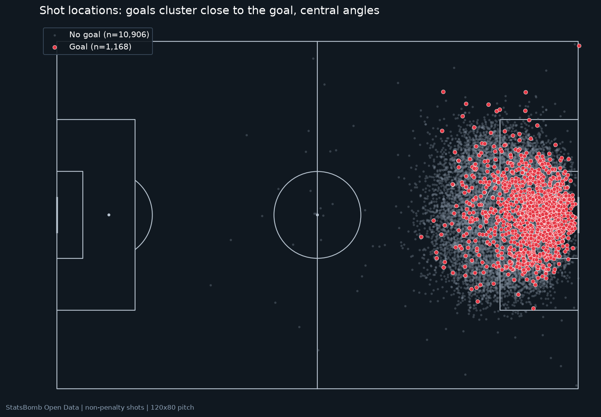

# PitchIQ — Expected Goals Intelligence

Shot-level expected goals (xG) built from StatsBomb Open Data and turned into
**actionable insight for coaches and analysts** — not just an accuracy
leaderboard.

> Data provided by **StatsBomb** via their Open Data initiative
> (https://github.com/statsbomb/open-data). All analysis and errors are ours.
> PitchIQ is an independent hackathon project and is not affiliated with
> StatsBomb.

## Live demo

**[▶ pitchiq-xg.streamlit.app](https://pitchiq-xg.streamlit.app)** — deployed
on Streamlit Community Cloud. First load takes ~1 minute (cold start) while
dependencies install and the model boots. Or run locally:

```bash
streamlit run app/streamlit_app.py
```

|  |
|---|
| *Exploratory shot map by outcome (goal/no goal). The live app's interactive Plotly map uses PitchIQ xG for size/colour and exposes filters and hover details.* |

## The problem

A coach asks: *which shots should we be taking, and which finishing cases are
real skill or luck?* Raw shot counts understate quality — a 40-yard daisycutter
and a one-touch finish goal count the same in the box score, but carry wildly
different probabilities. PitchIQ answers with a transparent xG model (every
input is known **before** the shot is taken) plus player/team/zone views that
lead directly to concrete instructions.

## What it does

1. **Shot Map** — every shot on an interactive pitch; size/colour = xG;
   hover for player, minute, context and outcome.
2. **xG Estimator** — pick position + body part + context, get the goal
   probability in real time, with distance/angle and a goal-mouth visual.
3. **Model Evaluation** — honest metrics (ROC-AUC, log loss, Brier,
   calibration curves) explained in plain language, benchmarked against
   StatsBomb's own xG on the same held-out matches.
4. **Insight Engine** — player/creator/finisher leaderboards, team shot
   selection, zone efficiency, and coaching hypotheses. Creator counts mean
   key-pass-linked shots, not the official assist total; rankings are scoped by
   team and competition.

## Results (regenerated with the audited pipeline, Oct 29 2026)

> **Evaluation framing.** Logistic Regression is the pre-declared deployment
> baseline for transparency; tuned-tree CV scores are exploratory comparators
> (nested CV is not yet implemented), so no claim is made that PitchIQ matches
> StatsBomb's specialist xG. Because the dataset was examined during
> development, the refreshed grouped holdout is a development evaluation, not a
> pristine independent benchmark. Protocol: `audit_protocol_version
> 2026-10-29-v1`, split seed `20261029`.

Grouped holdout: 96 matches / 2,459 non-penalty shots (train: 383 matches /
9,615 shots), zero match leakage.

| Model | ROC-AUC | Log loss | Brier | ECE |
|---|---|---|---|---|
| Logistic Regression (deployed) | 0.796 | 0.257 | 0.0732 | 0.020 |
| XGBoost (tuned, exploratory) | 0.784 | 0.263 | 0.0747 | 0.017 |
| Random Forest (exploratory) | 0.780 | 0.264 | 0.0747 | 0.017 |
| StatsBomb xG (benchmark) | 0.803 | 0.255 | 0.0724 | 0.020 |

* Ablation on the same holdout: distance+angle alone → AUC 0.756;
  + shot context → 0.781; **+ freeze-frame defenders/GK → 0.796**
  (+0.040 over geometry only).
* Raw probabilities already pass the out-of-fold calibration tolerance
  (slope 0.958, ECE 0.020) — no extra calibration layer needed.

### Headline findings (regenerated, audit-framed)

* **Aston Villa** — 54% of shots below 0.05 xG (xG/shot 0.073 vs 0.098 dataset
  mean). Replacing one third with ~0.10 xG chances would add ≈ **+5.2 xG**;
  a typed scenario, not a causal forecast.
* **Stoke City** — 59 shots (14%) from 30+ pitch-coordinate units: xG/shot
  0.017, 0 goals. Coaching hypothesis: review progression in those clips; low
  xG alone does not prove a shot was a mistake.
* **Counter-attacks** — mean xG 0.146 vs 0.097 in regular play (558 shots);
  a descriptive association to inspect on video, not a proven tempo effect.
* **Zone value** — the highest-value band (110+ / inside channel, mirrored
  y-bands) averages 0.178 xG on 27.5% of shots; a candidate entry-balance
  training point.
* **Messi (Barcelona, La Liga)** — 27 goals on 19.9 xG (**+7.06**, 190 shots);
  an observed residual — validate on a larger sample before calling it
  repeatable skill. Özil: 142 key-pass-linked shots for Arsenal (14.5 xG).

## Audit transparency

Full audit from Oct 29 2026: `PITCHIQ_Audit_Report.md` (findings P0–P2,
protocol changes) and `PITCHIQ_Pre_Submission_Checklist.md` (reproduction
steps). What changed after the audit: deployment model pre-declared (no
test-set selection), calibration chosen from training-only out-of-fold
predictions, player/creator tables scoped by player–team–competition,
regression tests for the selection policy and insights, fail-loud data
fetching, and assumption-labelled recommendation copy. Regeneration ran
end-to-end on this repository (22/22 tests passing).

## Data

| Competition | Season | Matches | Shots | Goals | Conversion |
|---|---|---|---|---|---|
| Premier League | 2015/2016 | 380 | 9,908 | 988 | 9.97% |
| La Liga (Messi framed) | 2019/2020 | 35 | 839 | 111 | 13.23% |
| FIFA World Cup | 2022 | 64 | 1,494 | 195 | 13.05% |
| **Total** | | **479** | **12,241** | **1,294** | **10.57%** |

Penalties (167) are reported but excluded from the model — a 12-yard
one-on-one is a different task. Freeze frames exist for 98.8% of shots.

### Leakage controls

* Split **grouped by `match_id`** (GroupShuffleSplit 80/20 + GroupKFold-5 CV).
* `shot.outcome` only builds the target; `shot_statsbomb_xg` is a benchmark,
  never an input; `shot_end_location` never enters the table.
* Every feature is justified in `reports/feature_justification.md`;
  11 geometry/feature tests, 2 model-policy tests, 7 insight-regression tests,
  and 2 headless app smoke tests guard the pipeline. The app tests require
  Streamlit and the other runtime dependencies to be installed.

## How to run

```bash
pip install -r requirements.txt

# full reproducible pipeline (downloads/caches StatsBomb events first run)
# PowerShell:  ./scripts/run_pipeline.ps1
# or step-by-step:
python -m src.data --workers 4 && python -m src.features && python -m src.eda
python -m src.train
python -m src.creators --workers 4 && python -m src.insights

# the app
streamlit run app/streamlit_app.py
```

Requires Python 3.11+. Run `python -m pytest tests/ -q`; 22 tests should run when all app dependencies are installed.

## Project structure

```
pitchiq/
├── app/streamlit_app.py        # 4-page Streamlit app (dark theme)
├── src/
│   ├── data.py                 # StatsBomb download + caching + audit
│   ├── features.py             # geometry, freeze-frame, preprocessor
│   ├── creators.py             # shot -> key pass -> assist creator
│   ├── train.py                # splits, ablation, tuning, calibration
│   ├── insights.py             # SHAP, permutations, leaderboards
│   └── eda.py                  # conversion rates + figures
├── models/                     # best_model.joblib + metadata.json
├── reports/                    # CSVs, markdown, figures (fig1..fig11)
├── scripts/run_pipeline.ps1    # end-to-end runner
└── tests/                      # geometry + app smoke tests
```

## Limitations & next steps

* 3 competitions, 479 matches — club data is limited to the selected 2015/16
  and 2019/20 seasons; model calibration and style may drift across leagues,
  seasons, and competitions.
* Freeze-frame features are pre-shot snapshots, not tracked pressure quality;
  estimator ignores defender/GK placement (median-imputed, flagged).
* Creator totals count resolved assisted shots; they are not a full causal or
  possession-value estimate (that would require event-level pass-chain modelling).
* goals − xG on < 30 shots is noise; the app flags small samples.
* Next: step-based EPV instead of a static angle model, calibration
  monitoring per competition, and a pass-chain xG added for creators.

## Credits & license

* Data: **StatsBomb Open Data** (CC BY-NC) via `statsbombpy`.
* Code: MIT License (see `LICENSE`).
